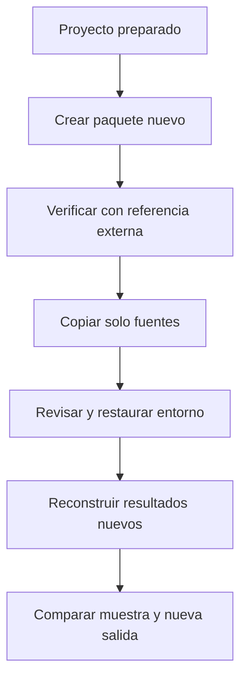

# 14.08 — Entrega y automatización opcional

[Inicio](../../../README.md) / [Módulo 14](../README.md) / **Lección 14.08**

| Tu sesión | Qué prepararás o comprobarás |
| --- | --- |
| **Meta** | Compartir fuentes y resultados que otra persona pueda revisar y reconstruir |
| **Necesitas** | Integración de 14.07, entornos locales y Quarto existente |
| **Evidencia** | Paquete verificado, copia reconstruida desde fuentes y límites explicados |

> **Opcional:** esta sección amplía la entrega local. La ruta esencial puede
> continuar directamente a 14.09. La extensión de CI también es
> opcional y no requiere activar un servicio para estudiar el material.

[**Hacer el lab 14.08 →**](../../../labs/14_reproducible_projects/08_delivery_optional_automation/README.md) · [Recorridos completos](recorridos.md)

## Propósito

«En mi equipo funciona» no explica qué debe recibir otra persona. Copiar una
carpeta completa puede arrastrar entornos, cachés, ensayos fallidos o rutas que
solo existen en el equipo de origen. Enviar únicamente el HTML permite leer
una fotografía, pero no reconstruir cómo se calculó.

Vamos a preparar una entrega local que distingue fuentes de muestra, declara
sus archivos y se contrasta con una referencia externa. Después copiaremos
**solo las fuentes** a otra carpeta y repetiremos el trabajo. Automatizar esos
pasos puede ayudar, pero aprobar una tarea automática no demuestra por sí solo
que el producto completo sea reconstruible ni que alguien lo haya comprendido.

## Antes de empezar

Revisa [14.07 — Integración de reporte y app](../07_report_app_integration/README.md),
[14.06 — Trazabilidad](../06_traceability_recovery/README.md) y
[14.03 — Entornos](../03_reconstructible_environments/README.md).
Elige Python/Streamlit o R/Shiny. Los preparadores reúnen **60 fuentes** y no
exigen entregas personales previas; al copiar no instalan ni ejecutan el producto.
Se conservan los entornos y lockfiles de 14.07, sin dependencias nuevas.

Trabaja con un escritor y sin cambiar archivos durante una operación. Los
destinos deben ser nuevos. Quarto no se instala automáticamente. Los
[recorridos](recorridos.md) separan preparación, restauración, construcción,
verificación, copia y reconstrucción; no mezcles sus estados.

## Qué vas a aprender

- Distinguir fuentes, muestra de resultados y archivos locales que no se distribuyen.
- Construir una entrega con inventario explícito y comprobarla con un CSV externo.
- Separar verificación de lectura y ejecución deliberada de código.
- Reconstruir resultados sin copiar el entorno ni la muestra anterior.
- Explicar qué automatiza una tarea local y qué cubre una plantilla de CI.

## Material de apoyo

| Recurso | Para qué sirve | Uso |
| --- | --- | --- |
| [Recorridos](recorridos.md) | Preparar y ejecutar una ruta completa | Elegir uno |
| [Preparador Python](preparar.py) / [R](preparar.R) | Reunir 60 fuentes en carpeta nueva | Según lenguaje |
| [Entrega Python](plantilla/entrega.py) / [R](plantilla/entrega.R) | Crear, verificar o copiar fuentes con operaciones separadas | Esencial dentro de esta práctica |
| [Reconstrucción Python](plantilla/reconstruir.py) / [R](plantilla/reconstruir.R) | Ejecutar pruebas, tres consultas y tres reportes | Tras revisar fuentes/restaurar |
| [Catálogo](plantilla/catalogo.csv) | Lista explícita de los archivos fuente incluidos | Inspeccionar |
| [LEEME del producto](plantilla/LEEME.md) y [manual de entrega](plantilla/LEEME_ENTREGA.md) | Preparar al autor y orientar al receptor | Leer |
| [CI_EJEMPLO.yml](plantilla/CI_EJEMPLO.yml) | Estudiar una tarea manual de pruebas Python | Ampliación, sin activar |
| [Referencia sintética](../01_product_question_contract/cartera.csv) y [contrato](../01_product_question_contract/ESPECIFICACION.md) | Contrastar filas, unidades y reglas | Referencia externa al paquete |

## 1. Un ejemplo pequeño: qué necesita quien recibe

Imagina dos observaciones sintéticas del corte 2026-10-31: 001 con 100 MXN y
003 con 2600 MXN. El ID es texto; la clave es ID/corte. Seleccionar saldos
mayores o iguales a 2000 devuelve 003/2600 sobre dos créditos y 2700 MXN de
universo: cobertura 1/2 = 50%.

Un HTML con 003/2600 no permite saber si el universo era de dos o tres créditos.
Para reconstruir hacen falta datos completos, regla, parámetros, código y
preparación del entorno. Para revisar la fotografía hacen falta también contexto
y una referencia que no proceda únicamente del resultado que se intenta validar.

```text
fuentes/       datos + contrato + configuración + código + metadatos
muestra/       resultados ya calculados para comparar
LEEME.md       cómo revisar y reconstruir
ENTREGA.csv    versión del formato y ruta de aplicación elegida
MANIFIESTO.csv lista de archivos y huellas
```

Predice qué fallaría si copias solo muestra/, o si envías tu .venv como sustituto
del lockfile. La primera opción deja una fotografía sin receta; la segunda
transporta una instalación ligada a un entorno, sin demostrar que pueda
restaurarse desde sus metadatos. Ninguna sustituye reconstruir en otra carpeta.

## 2. El alcance real del paquete de esta práctica

La base completa mantiene seis observaciones sintéticas: tres créditos en
septiembre y tres en octubre. Saldos MXN enteros conocidos, IDs de tres dígitos,
segmentos comercio/servicios, fechas válidas y claves ID/corte únicas. Se valida
toda la fuente, incluso registros fuera de la selección. El paquete reúne:

| Parte | Archivos | Qué contiene |
| --- | ---: | --- |
| fuentes/ | 60 | Datos, contrato, configuraciones, código, pruebas, metadatos e instrucciones |
| muestra/salidas/ | 12 | Selección, contexto, insumos y marca de tres consultas |
| muestra/reportes/ | 15 | Tablas, producto.csv, .qmd y HTML de tres reportes |
| Archivos superiores | 3 | LEEME, descriptor y manifiesto |
| **Total** | **90** | Manifiesto con las huellas de los otros 89 archivos |

Los casos están fijados; este constructor no empaqueta cualquier proyecto ni
cualquier conjunto de reportes. Reutiliza los filtros de 14.07:

| Caso | Filtros | Detalle esperado | Universo / cobertura |
| --- | --- | --- | --- |
| Octubre | Ambos segmentos, mínimo 2000 | 003/2600 | 3 créditos, 4600 MXN / 1/3 |
| Septiembre | Ambos, mínimo 2000 | 002/2000 y 003/2500 | 3 créditos, 4500 MXN / 2/3 |
| Vacío | Octubre, servicios, mínimo 1901 | Sin filas, 0 MXN | 3 créditos, 4600 MXN / 0% |

Noviembre conserva su configuración sin universo, pero no produce una entrega
de muestra. No se transforma esa ausencia en una selección válida con cero.
El denominador de cobertura es el número de créditos del corte.

## 3. Una lista explícita evita copiar el directorio de trabajo

`catalogo.csv` enumera las 60 fuentes. El constructor agrega solo los archivos
de muestra definidos y los documentos superiores. No copia por extensión ni
recorre toda la carpeta de trabajo para incluir «lo que encuentre».

Quedan fuera .venv, renv/library, cachés, ensayos, intentos con rutas locales,
especificaciones privadas y bitácoras personales. Las dos interfaces se conservan
como fuentes, pero quien recibe elige una y restaura solo su entorno.

La lista delimita nombres, no limpia el contenido. Si alguien escribe una
credencial o un dato personal dentro de un archivo permitido, la lista no lo
convierte en material público. Antes de compartir se revisan datos sintéticos,
instrucciones, código y contenido. En esta práctica no hay envío automático a
terceros, publicación de una app ni carga de paquetes a un servicio.

El catálogo usado por el revisor viene de sus herramientas locales revisadas.
El catálogo recibido se compara con él: no se usa como permiso para leer rutas
arbitrarias. Los enlaces y las rutas inyectadas en el manifiesto se rechazan.

## 4. Qué comprueba el verificador de solo lectura

La operación de verificación se ejecuta desde herramientas revisadas, fuera
de la entrega. Python verifica la ruta Streamlit y R la ruta Shiny; no se exige
usar ambos ni se implementa aquí un revisor cruzado entre lenguajes.

| Control | Para qué sirve |
| --- | --- |
| Inventario exacto de archivos y huellas | Detectar faltantes, extras y cambios de bytes |
| CSV externo, fuera del paquete | Comparar toda la fuente por clave y campo, sin depender de su orden |
| Configuraciones del plan | Impedir cambiar la pregunta aunque la selección coincida |
| Modelo local del revisor | Recalcular selección, universo y cobertura sin ejecutar código recibido |
| Insumos y marcas de muestra | Relacionar resultados con los bytes incluidos |
| Tablas, .qmd y sección calculada del HTML | Conciliar la fotografía con los valores esperados |

Las reglas de cálculo se reutilizan; no se reescribe la selección en cada
interfaz. La copia de 14.08 permite pasar una raíz de datos a los helpers del
pipeline. En R, el revisor pasa explícitamente sus funciones locales para no
hacer source de archivos recibidos. Las fuentes de secciones anteriores se
conservan intactas.

**No ejecutar código recibido es una propiedad concreta:** se leen sus bytes
para las huellas, pero el cálculo y la presentación esperada usan funciones del
revisor. No se dispara .Rprofile ni se importa el modelo del paquete al verificar.
Restaurar y ejecutar el producto ocurren después, como acciones explícitas.

### Una aprobación numérica tiene límites

MD5 compara bytes, no autentica. Un manifiesto editable puede regenerarse tras
una modificación. Por eso también se comparan fuente externa, claves, filtros,
denominadores y valores. Aun así, obtener datos conciliados no aprueba todo el
código: alguien podría cambiar una función no ejecutada por el revisor y
actualizar sus huellas. Se requiere revisión humana antes de ejecutarla.

El verificador examina la sección calculada del HTML, no certifica todo el
documento ni accesibilidad completa. Las fechas UTC se validan en forma y
calendario, pero no autentican sesiones pasadas. Leer el HTML y observar la app
siguen siendo comprobaciones distintas de validar sus tablas.

## 5. Crear, copiar y reconstruir son operaciones diferentes



Sin renderizador: primero se arma y comprueba un paquete. Se copian sus fuentes
a otra carpeta, se revisan, se restaura un entorno local y se ejecutan otra vez.
No se copian resultados de muestra para afirmar que se reconstruyeron.

1. **Crear** exige tres consultas/reportes previamente comprobados en el proyecto
   preparado. Usa una carpeta nueva fuera de ese proyecto.
2. **Verificar** solo lee y exige un CSV de referencia externo al paquete.
3. **Copiar fuentes** verifica primero y crea otra carpeta; no instala ni ejecuta.
4. **Reconstruir** es un script deliberado: comprueba entorno, ejecuta siete
   grupos de pruebas, traza tres consultas y prepara/renderiza tres reportes.
5. **Abrir la app** se hace por separado, después de restaurar la interfaz elegida.

Los nombres de salida son explícitos. Si ya existen, se rechazan: un reintento
no debe mezclar resultados ni reemplazar evidencia. Un fallo conserva la
carpeta parcial. No hay limpieza automática, transacción de todo el producto ni
garantía de entrega correcta por encontrar un manifiesto. Revisa el diagnóstico
y, para repetir todo el protocolo, usa otra copia nueva.

Un lockfile declara cómo restaurar; no contiene Python, R, Quarto ni todos sus
instaladores. Restaurar puede necesitar descargas o cachés locales adecuados.
No prometemos reconstrucción offline en cualquier equipo. La revisión de autoría
separa lo comprobado en Windows de Linux/macOS y de operar toda la interfaz del IDE.

## 6. Automatizar localmente sin confundir el alcance

`reconstruir.py` y `reconstruir.R` reúnen pasos ya conocidos. Detienen el proceso
ante un error y conservan los archivos. No instalan paquetes, no eligen reglas
de limpieza por ti, no inician servidores y no reintentan indefinidamente.

Automatizar permite repetir instrucciones; demostrar reconstrucción requiere
además una copia nueva, entornos restaurados, resultados comparados y decisiones
explicadas. El [lab](../../../labs/14_reproducible_projects/08_delivery_optional_automation/README.md)
trabaja esa diferencia con una alteración controlada y otra carpeta de fuentes.

## 7. Ampliación: CI manual como ejemplo, sin activarlo

[CI_EJEMPLO.yml](plantilla/CI_EJEMPLO.yml) describe una tarea de GitHub Actions
para **otro repositorio cuya raíz contenga las fuentes del producto**. No está
en .github/workflows, por lo que este material no habilita Actions en DS Track.
Puedes estudiarlo y comprobar su comando local sin crear un repositorio remoto.

| Elemento | Decisión del ejemplo |
| --- | --- |
| Disparador | workflow_dispatch: ejecución manual |
| Permisos | contents: read; checkout sin persistir credenciales |
| Acciones | checkout y setup-python fijadas a SHA completos consultados en sus repositorios oficiales |
| Entorno | Windows del proveedor y Python 3.12.12 |
| Tarea | Crear .venv sin pip y ejecutar pruebas.py; el cálculo no requiere paquetes externos |
| Límite | Diez minutos; fallo devuelve código distinto de cero |

Se comprueba el comando localmente. No se acredita una ejecución hospedada ni
se activan workflows como parte de esta lección. Si decides habilitarlo en un
repositorio separado, revisa antes sus acciones, permisos, rutas y comportamiento.
No copies la plantilla a la raíz de DS Track esperando que encuentre pruebas.py.

Un SHA fija el código de una acción, pero windows-latest, el servicio y las
descargas del runner pueden cambiar. Este ejemplo no restaura uv/renv, renderiza
Quarto, abre la app, construye el paquete ni publica productos. Una marca verde
solo informa sobre ese trabajo y esa revisión; no equivale al cierre del módulo.

## Práctica, evidencia y criterio de salida

Realiza el [lab 14.08](../../../labs/14_reproducible_projects/08_delivery_optional_automation/README.md).
Conserva paquete, referencia externa, comando y resultado de verificación,
copia de fuentes, versiones y salidas reconstruidas. Compara por crédito y
filtro, además de sumas, universo, cobertura y presentación. Explica qué
aprobó el verificador y qué revisaste al ejecutar el producto.

Quien acompaña debe poder localizar las fuentes necesarias y reconstruir sin
copiar muestra/ ni un entorno instalado. Guarda tu práctica en tu copia personal;
PROGRESS.md documenta autoría. La entrega de referencia no acredita aprendizaje
ni activa proyectos/checkpoints. La revisión final y defensa de decisiones se trabajan en
14.09, disponible con su lab.

## Referencias primarias

- [uv: bloqueo y sincronización](https://docs.astral.sh/uv/concepts/projects/sync/): uso de --locked y restauración del entorno.
- [renv: restore](https://pkgs.rstudio.com/renv/reference/restore.html): biblioteca del proyecto y lockfile.
- [GitHub Actions: sintaxis de workflows](https://docs.github.com/en/actions/reference/workflows-and-actions/workflow-syntax): eventos, permisos, jobs y pasos.
- [GitHub Actions: uso seguro](https://docs.github.com/en/actions/reference/security/secure-use): permisos y referencias de acciones.
- [checkout](https://github.com/actions/checkout) y [setup-python](https://github.com/actions/setup-python): fuentes oficiales de las acciones del ejemplo.

## Siguiente paso

[Volver al módulo](../README.md) · [Lab 14.08](../../../labs/14_reproducible_projects/08_delivery_optional_automation/README.md) ·
[14.09 — Revisión final y defensa de decisiones](../09_final_review_defense/README.md), disponible con su lab.
